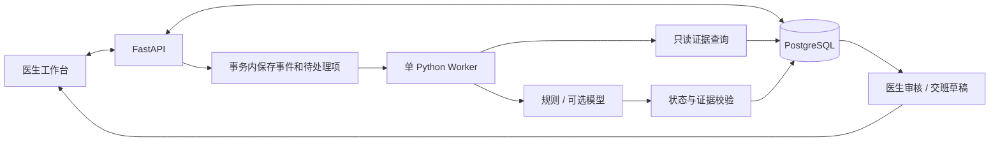

# Medical Agent Assistant · 医疗工作流辅助 Agent

面向住院医生的医疗工作流原型，探索从查房记录、病历辅助书写到检验结果随访和交班的连续协作。

当前仓库包含医生端交互原型和 FastAPI + PostgreSQL 病历后端。下一阶段开发重点是：**把医生提出的随访计划变成持久化任务，关联检验结果与原始证据，由医生确认后继续跟进，并将未完成事项带入交班。**

> 项目处于原型开发阶段，使用虚构数据。任务闭环、后台 Worker、真实模型和医院系统接入尚未实现；当前签署是开发模拟，不是正式电子签章。

## 当前实现与限制

| 模块 | 当前情况 |
| --- | --- |
| 医生工作台 | 单文件 HTML/CSS/JavaScript；提供导航、统计卡片、患者搜索和筛选 |
| 患者详情 | 提供概览、病历时间线、医嘱和检验展示；内容主要为固定演示数据 |
| 病历文书 | 列表、正文查看、编辑和模拟签署；后端支持查询、修改和签署状态保存 |
| 查房记录 | 文本录入和固定病程示例；尚未接入语音识别或真实草稿生成/保存接口 |
| PostgreSQL | 已定义医生、患者、病历三张表，提供虚构数据初始化接口 |
| 交班与提醒 | 当前是展示内容，尚未根据持久化临床任务生成 |
| 身份与审计 | 尚未实现真实登录、患者授权校验或完整审计 |

前端 API 适配仍有待修复之处：首次进入病历模块未必触发数据库加载；后端空列表可能继续展示本地演示数据。现阶段不能将界面上的所有提示视为数据库操作成功。修复这些问题是下一阶段的第一项任务。

## 下一阶段 MVP

参考 [ClinLoop](https://github.com/legend91019/ClinLoop) 的任务连续性、证据核对和医生审核思路，在现有项目上逐步实施检验随访闭环。

```text
查房：血培养结果出来后通知我
  → 提取候选随访任务
  → 医生确认，持久化等待条件
  → 模拟检验报告返回
  → 核对患者、此次住院、检验项目及报告来源
  → 生成带证据的待审核提醒
  → 医生查看报告、记录处理结论
  → 如需继续等待药敏，建立后续任务
  → 未完成事项进入交班草稿
```

第一版只支持 `FOLLOW_RESULT`（跟进检验结果）和“结果可用，但在检索范围内未找到医生确认记录”这一类提醒。接受提醒、确认已查看报告和关闭任务是不同操作。

### 开发任务

详细依赖、文件、步骤和完成标准见 [MVP 开发任务清单](docs/plans/MVP_TASKS.md)。

| 编号 | 待实施任务 |
| --- | --- |
| 01 | 修复前后端连接、字段映射与演示/联机模式 |
| 02 | 拆分后端，引入 Alembic 数据库迁移 |
| 03 | 增加住院信息与开发医生访问范围 |
| 04 | 定义任务状态、事件契约和转换约束 |
| 05 | 持久化查房、临床事件与待处理队列 |
| 06 | 提取候选随访任务并由医生确认 |
| 07 | 建立可恢复、可重试的单 Worker |
| 08 | 匹配检验报告，生成证据和待审核提醒 |
| 09 | 实现医生审核、结果确认和审计 |
| 10 | 完成医生端任务看板与证据详情 |
| 11 | 根据未完成任务生成交班草稿 |
| 12 | 补齐病历草稿保存与查房来源关联 |
| 13 | 增加可选真实模型适配器 |
| 14 | 完成回归、合成病例评测和交付文档 |

先完成规则驱动的完整链路和验收，再接真实模型。第一版继续扩展现有前端；React、Redis、MCP、AgentArts 均不作为前置条件。

## 技术与架构

当前使用 HTML/CSS/JavaScript、FastAPI、SQLAlchemy 和 PostgreSQL，依赖见 `backend/requirements.txt`。

以下为待实施的目标架构，Worker、任务状态服务和证据链尚未落地：



## 本地运行当前原型

建议使用 Python 3.12+ 和一个专用 PostgreSQL 开发数据库。当前前端不需要 Node.js。

### 1. 创建数据库并配置连接

在 PostgreSQL 中创建空的开发数据库：

```sql
CREATE DATABASE health_agent;
```

在仓库根目录执行；已有 `.env` 时不要覆盖：

```powershell
if (-not (Test-Path .env)) { Copy-Item .env.example .env }
```

编辑 `.env`，填写自己的连接信息。密码中的特殊字符需要进行 URL 编码。

```dotenv
DATABASE_URL=postgresql+psycopg://用户名:密码@localhost:5432/health_agent
CORS_ORIGINS=http://localhost:5500,http://127.0.0.1:5500
```

### 2. 启动后端

从仓库根目录执行：

```powershell
python -m venv .venv
.\.venv\Scripts\python.exe -m pip install -r backend/requirements.txt
.\.venv\Scripts\python.exe -m uvicorn backend.main:app --host 127.0.0.1 --port 8000 --reload
```

当前后端默认不在启动时隐式建表；请先执行 Alembic 迁移。若仅做一次性本地原型，可在 `.env` 设置 `AUTO_CREATE_TABLES=true`，共享开发库不建议启用。

接口文档：[Swagger UI](http://127.0.0.1:8000/docs)。

### 3. 可选：写入虚构演示数据

在另一个终端执行，仅用于专用开发数据库：

```powershell
Invoke-RestMethod -Method Post http://127.0.0.1:8000/api/dev/seed
```

当前初始化接口创建两个医生、三个患者、四次住院（其中一个患者两次住院）及三份病历；使用固定业务 ID，重复执行不会重复插入。

### 4. 启动前端

在仓库根目录的另一个终端执行：

```powershell
.\.venv\Scripts\python.exe -m http.server 5500 --bind 127.0.0.1
```

打开 [医生工作台](http://127.0.0.1:5500/index.html)。前端 API 默认地址为 `http://127.0.0.1:8000/api`。

也可直接打开 `index.html` 体验界面，但当前 CORS 默认配置面向上述 HTTP 地址，连接后端时应使用 HTTP 方式访问。

## 已实现 API

| 方法 | 路径 | 用途 |
| --- | --- | --- |
| GET | `/api/health` | 返回服务状态；目前不执行数据库连通性探测 |
| GET | `/api/medical-records` | 病历列表，支持 `q`、`status` |
| GET | `/api/medical-records/{id}` | 病历详情 |
| PATCH | `/api/medical-records/{id}` | 修改未签署病历正文 |
| POST | `/api/medical-records/{id}/sign` | 保存模拟签署状态 |
| POST | `/api/dev/seed` | 初始化虚构演示数据 |

上述接口尚无身份认证，仅用于本地原型开发。事件、任务、审核和交班接口见任务清单中的后续设计。

## 仓库内容

```text
index.html                    医生端单文件原型
backend/main.py               当前 FastAPI 服务与数据模型
backend/requirements.txt      后端依赖
backend/README.md             后端说明
.env.example                  PostgreSQL 配置示例
docs/plans/MVP_TASKS.md        逐项开发清单
docs/plans/2026-10-16-clinical-workflow-mvp-task-book.md
                              升级方案、业务约束和验收规划
UPDATE_NOTES.md               初版功能与后续方向说明
```

## 验证与评测计划

第一、第二层已加入领域状态机和 DTO 单元测试。后续重点验证：不同患者/住院不误关联、重复事件不重复建任务、服务重启可恢复、报告修订可追踪、未审核不自动关闭任务，以及交班保留未完成事项。

规则、模拟模型和真实模型应分开报告。用独立合成病例统计提醒精确率、召回率、证据有效率、处理失败数和交班遗漏；没有实际测评前不宣称准确率或节时效果。

## 数据与使用边界

示例仅使用虚构病例，不上传真实患者信息、录音、数据库、密钥或 `.env`。`.gitignore` 应与源码一起提交；`.env.example` 只保存占位值。

项目用于软件原型与研究验证，不用于真实诊疗。未来模型输出只提出候选任务和提醒；正式任务状态由后端规则和医生操作控制，系统不自动诊断、开立医嘱或关闭高风险临床任务。
