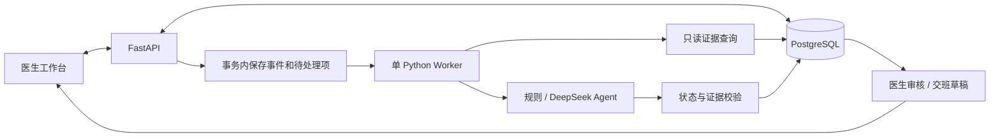

# Medical Agent Assistant · 医疗工作流辅助 Agent

面向住院医生的医疗工作流原型，探索从查房记录、病历辅助书写到检验结果随访和交班的连续协作。

当前包含三条流程：**入院问诊与检查 → Agent入院草稿 → 医生审查签署；查房语音／文字 → 暂存或完成查房；保存入院问诊／完成查房 → 后台Agent自动提取问题与计划 → 医生确认 → 事项记忆与正式待办 → 自动进展调查 → 医生批准下一步行动 → 版本化交接。** 原有检验随访、证据审核及交班工作流继续保留。

> 项目使用虚构数据。基础工作流仍为规则版；现已新增 DeepSeek 适配、模型动作循环、只读取证、医生候选审核、事件恢复和交接快照。A02～A07 已通过本地集成验证，另有三类真实 DeepSeek 合成调查通过；未接医院生产系统。语音使用浏览器识别，签署为开发模拟。

## 连续跟进与质量复盘（2026-11-03）

入口仍为 **患者姓名 → 待跟进事项**。工作摘要展示本次住院的待确认、有进展待处理、已到计划时间及持续跟进事项；点击摘要中的事项可定位卡片。摘要由当前事项与已读取证据归纳，不额外调用模型，随后台调查结果刷新，不覆盖医生正在填写的内容。

本轮完成五项优化：

1. **证据与完成条件**：按复查、信息核实、联系等事项展示需要核对的资料。报告只与明确的事项对象、原安排之后的时间及唯一报告来源对应，不再用邻近原文中的其他项目匹配；修订报告使用最新版本，不明确时交给医生核对。报告返回、已阅和完成分别记录。当前报告未阅时，医生完成事项前须明确确认审阅并填写处理结论；完成审计保存当时的证据版本。未接入系统的实际执行仍可由医生如实记录结论。
2. **跨次查房关联**：后续查房的执行、改期、取消等信息继续触发原事项调查与建议；重复候选经医生核对可关联已有事项，不新增正式待办。原事项时间线保留原始安排、后续关联片段、历次调查、医生修改及建议处理。正式改期、修改、取消仍由医生决定，不覆盖原始记录。
3. **固定质量评测**：为7类完全合成资料定义版本化工程标注，统计误提、漏提、逐字证据匹配及重复检测，并可与同标注版本的基线比较。支持离线重放已有模型输出和重新调用模型。标注由开发维护，尚未经临床专家裁定；小样本指标不能解释为临床准确率。
4. **医生反馈留档**：每个事项可提交提取错误、上下文不足、重复、证据错误等具体说明；忽略、补充、修改和关联操作也保留归档信息。患者页底部可复盘最近100条反馈，操作默认分类与医生主动反馈有区分。反馈仅用于复盘与人工维护评测集，不会自动训练模型、改变临床规则或修改事项。
5. **患者工作摘要**：卡片直接显示下一步，摘要提供证据名称与定位入口；进展证据可以跳转报告或对应问诊原文。详细时间线、质量反馈与自动提取工具按需展开，仍集中在患者详情。

新增接口：`GET /api/agent/matters/{id}/timeline`、`POST /api/agent/matters/{id}/quality-feedback`；原事项列表增加`completion_contract`、`work_summary`和`quality_feedback`，跟进反馈增加患者住院摘要。接口均检查医生及住院范围，写入检查事项版本。

```powershell
# 重放此前的合成模型输出，建立可比较基线（不联网）
python -m agent.patient_memory.evaluation --artifact docs/verification/extraction-quality-deepseek-2026-11-03.json
# 重新运行模型并与基线比较（只发送固定合成文本）
python -m agent.patient_memory.evaluation --online --output docs/verification/extraction-benchmark-online-2026-11-03.json --baseline docs/verification/extraction-benchmark-latest.json
# 用合成资料验证连续跟进，独立保存结果
python -m agent.patient_memory.progress.smoke --output docs/verification/matter-workflow-progress-deepseek-2026-11-03.json
```

本轮验证：177项自动化测试、完整隔离浏览器流程、7类DeepSeek合成提取及4类合成跟进场景通过。详细范围见[五项优化验证记录](docs/verification/continuous-workflow-2026-11-03.md)。

本轮复用现有事项、进展、建议和审计表；数据库最新版本仍为`0013_extraction_quality`。更新代码后重启API与事项Worker。未接入HIS/LIS，跟进仅基于本项目已保存的资料；“未找到记录”不能推断“临床未执行”。

## Agent 代码架构

Agent 专属实现集中在根目录 [agent/](agent/README.md)，按 core、llm、tools、guard、runtime、persistence、api、frontend 和 evaluation 划分。业务调用链和阅读顺序见架构说明，配置与操作见 [Agent 使用说明](agent/USAGE.md)。

## 患者事项记忆：第一层（2026-10-30）

目标是记住本次住院中医生明确提出的问题和计划，不再只生成一次性文书。入口为 **患者姓名 → 待跟进事项**。查房完成后自动提取，页面也有“查看自动提取的候选事项”入口。

### 提取质量准入（2026-11-03）

提取与独立语义复核分两次有界DeepSeek调用；后端再验证动作／对象是否逐字来自原文、标题是否保留对象、明确否定／已完成表述、来源及重复引用范围。一般治疗方向不新增候选；“完善检查”“复查炎症指标”保留为需医生补充的候选，不能直接进入待办。模型复核和规则仍不能证明临床正确性。

- 需补充的候选：展开“核对并确认事项”，补充动作、具体对象、后续核对资料类型、实际安排说明，并同步修改标题，再确认。补充作为医生安排单独留存，不覆盖原始问诊。
- 可能重复：核对本次住院最近100项候选、正式及已完成事项。医生选择关联（不创建新待办、不改变原事项）或说明另一项独立安排；不自动合并。同名复查可能是不同时间的安排。
- 旧版候选：保留原记录，提示补充或重新识别；不会覆盖已确认、完成或取消的安排。后台不因升级自动重跑所有历史来源。
- 在“自动提取状态与重试”中可查看被排除内容及原因。固定7类真实模型合成验证用 `python -m agent.patient_memory.quality_smoke`，保留首轮失败和最终结果于`docs/verification/extraction-quality-deepseek-2026-11-03*.json`；不是临床准确率评估。
- 当前迁移为`0013_extraction_quality`，运行`python -m alembic upgrade head`后重启API及事项Worker。两个模型请求合计最多约130秒，提取恢复租约为180秒；保存问诊不等待模型。

### 使用流程

1. 在入院记录页保存问诊转录，或在查房页“保存并完成本次查房”。系统在同一事务内持久化自动提取作业；查房仅暂存时不提取，未保存内容不参与。
2. 后台Worker自动调用DeepSeek提取原文中的明确事项，不生成查房总结。患者详情内显示排队、识别、待确认、无明确事项或失败状态，不再需要先点识别按钮。手动识别按钮保留为重新识别／失败重试入口。
3. Agent提出候选，类别包括待核实信息、复查计划、联系／安排和其他明确待办。候选卡片显示来源与时间、含上下文的逐字片段及原文跳转；质量不明和可能重复时会提示核对。
4. 医生核对标题、选择本次住院范围内的负责人、设置具体计划时间后，点击“确认核对结果”。不需要的候选填写原因忽略。候选不会直接计入正式待办。
5. 已确认事项显示为“进行中”，进入首页待处理事项和任务安排；可修改安排；点击“记录完成情况”展开填写区，填写实际执行结果后点“保存并完成事项”。空内容和网络失败在当前事项就近提示，失败保留文字；成功后展示已完成状态与记录。取消必须填写原因。刷新、重新打开仍保留原文依据与处理记录。

| 原文示例 | Agent候选 | 时间及负责人 |
| --- | --- | --- |
| “药物过敏史还需向女儿核实” | 待核实信息：向女儿核实药物过敏史 | 原文无时间，由医生安排 |
| “明天复查血常规” | 复查计划：复查血常规 | 保留“明天”，由医生选择具体时间，不虚构钟点 |
| “请联系心内科会诊” | 联系／安排：联系心内科会诊 | 医生确认负责人及时间 |

### 持久化与约束

- `patient_matters`保存类别、标题、原文引用、来源快照与摘要、负责人、计划时间、状态和版本；`patient_matter_scans`保存识别状态、模型和错误分类；医生操作进入现有审计表。
- 同一来源版本识别成功后直接复用结果，不重复调用模型或创建候选。来源更新自动排新作业；旧候选禁止确认，已确认事项保留旧依据并显示来源变化。
- 自动提取失败最多尝试3次，延迟重试；Worker中断后可恢复。更新至`0013_extraction_quality`并重启API和事项Worker。Worker也会补查在院患者已保存的入院问诊及已完成查房，出院资料不自动扫描。
- 每次请求限定患者住院及医生范围。模型必须给出原文中实际存在的引用，时间表达也必须出自该引用；校验失败或模型连接失败不生成正式任务，原文保留。
- 明确分开“候选、跟进中、已完成、已忽略、已取消”。模型只提出候选，不自动指派负责人、调整既有事项、标记已完成或开立医嘱。
- 当前只读取入院问诊原文与查房原文，不将Agent生成的病历反复当成新的问诊依据。跨来源语义去重仍需医生核对；现有检验OpenLoop和事项记忆尚未自动合并。

**第一层能力保留。** 已确认事项现可进入下述第二层后台进展跟进；保存入院问诊／完成查房会自动触发候选识别，手动识别保留为重试入口。正式完成、计划调整仍需医生操作，第三层现已实现下述行动候选、医生批准与交接联动。引用校验保证出处可追溯，不等于对模型语义理解或医疗内容正确性的自动认证。

### 代码与运行

- `agent/patient_memory/`：契约、模型适配、来源读取、持久化及审核API；`agent/frontend/patient-matters.js`：患者事项页面。
- 新库或更新环境运行 `python -m alembic upgrade head`，当前最新迁移至 `0013_extraction_quality`（包含第一层0009和第二层0010），保留已有查房和病历数据；然后重启API。
- 复用本地 `.env` 中的DeepSeek配置；API进程需要能够连接配置的模型服务，不能只以数据库健康检查作为模型联网验证。
- API：`GET /api/agent/encounters/{id}/matters`、`POST .../matters/scan`、`POST /api/agent/matters/{id}/review`、`GET /api/agent/matter-tasks`。
- 自动检查：`python -m pytest -q`。隔离浏览器验证使用注入模型，覆盖原文识别、缓存去重、医生修改／确认、正式任务及完成读回。
- 真实模型合成验证：`python -m agent.patient_memory.smoke`。仅使用固定合成文本，不读取开发库；结果见 `docs/verification/patient-matters-deepseek-2026-10-30.json`，本次识别出3类有原文依据的候选。

## 患者事项进展跟进：第二层（2026-10-31）

第一层确认事项后，系统持续核对本次住院资料，反馈“是否有新进展”，正式事项仍由医生处置。**不生成查房总结，不自动完成事项、不自动取消或改写医生计划。**

### 操作与反馈

1. 在“待跟进事项”中确认一条问题或计划。确认或调整安排时，会持久化一条进展调查作业。
2. 后台Worker每5秒检查已确认且仍在跟进的事项，比对已保存的入院问诊、查房原文、病程更新及本次住院最新版本检验报告；来源版本、事项版本或到期状态变化时排队，不因普通页面刷新重复调用模型。
3. 跟进反馈统一位于患者详情的“待跟进事项”；事项卡片显示进展、逐字证据、报告版本和查询范围，每5秒更新，保留未提交的标题、负责人、时间与备注。
4. 医生可以“标记已阅”；该操作只清除本条反馈的待查看标记，不完成正式事项。完成、取消或修改计划继续使用原事项操作，填写实际处理依据。
5. 原文、报告或事项版本更新后，旧反馈显示过期，不能确认旧版本；后台核对新版本后给出新反馈。页面提供手动检查和失败重试，模型失败保留正式事项。

| 反馈 | 含义 |
| --- | --- |
| 仍在等待 | 本次已读取资料中尚无明确进展，不等于现实中未执行 |
| 发现响应记录 | 新记录明确记载核实、联系或执行情况，医生仍需核对 |
| 相关结果已到 | 明确对应的检查报告已返回，等待医生查看 |
| 资料存在冲突 | 新资料之间有矛盾，需要人工核实 |
| 计划可能已变化 | 新医生记录明确调整或取消原计划，等待医生决定如何更新正式事项 |
| 需要人工核对 | 计划与结果不能明确对应，或查询覆盖不足 |

### 运行方式

先运行数据库迁移，然后启动API及进展Worker（API和Worker均须能够访问本地配置的DeepSeek服务）：

```powershell
python -m alembic upgrade head
python -m uvicorn backend.main:app --host 127.0.0.1 --port 8000
# 另一个终端运行，持续自动跟进：
python -m agent.patient_memory.progress.worker --poll-interval 5
```

也可用原统一Worker `python -m backend.worker.main --poll-interval 1`，已集成第二层队列。选择一种运行即可；`--once`用于单轮调度与处理。**只启动网页和API不会执行模型调查**，作业仍可持久化并在Worker恢复后继续。

### 技术与当前边界

- 迁移 `0010_matter_progress` 新增持久化作业和进展记录，保留既有数据。工作进程用租约领取，网络请求期间不持有临床写锁；提交前重新校验事项及全部来源摘要。
- 通过周期性来源版本核对实现自动触发，不依赖每条API调用都成功发送通知，重启后可发现漏处理变化。当前不接医院实时消息总线。
- 同一事项版本和资料快照只生成一个作业。失败延迟重试最多3次；耗尽后明确提示医生重试。旧版本或已结束／出院事项的待处理作业不再提交当前反馈。
- 当前查询上限为最近30段问诊、20条病程更新、30份各报告最新版本检验，模型文本总量有上限。截断时明确显示范围；资料不足不能断言“无进展”。
- 原计划不能作为已执行的依据。报告对应采用保守校验：项目须能明确对应原文、时间不早于计划、来源唯一；多个同项目报告、旧报告或项目含糊时转为人工核对，不宣称完成复查。
- 这不是临床执行事实认证。模型只比较已保存资料，逐字引用和范围校验不替代医生判断。第二层只产生进展观察；第三层在下文提供下一步建议，仍须医生批准才生成子事项或修改正式安排。
- 代码位于 `agent/patient_memory/progress/`；前端位于 `agent/frontend/matter-progress.js`。
- API：`GET /api/agent/matter-progress-feedback`、`GET /api/agent/matters/{id}/progress`、`POST .../progress/check`、`POST .../progress/acknowledge`、`POST .../progress/retry`。
- 测试覆盖新查房恢复、报告修订、范围隔离、旧反馈拒绝、已阅不完成、并发变化、超时重试与租约恢复。真实模型合成验证：`python -m agent.patient_memory.progress.smoke`，轨迹见 `docs/verification/matter-progress-deepseek-2026-10-31.json`，不读取开发库患者信息。

## 下一步行动与交接：第三层（2026-10-31）

第二层进展调查现在可同时提出下一步行动，显示在事项卡片的 **“下一步行动建议与审核历史”** 中。每张卡片显示依据、建议原因、批准后执行效果及审核记录；Agent不直接执行建议。

| 行动 | 适用情形 | 批准后的变化 |
| --- | --- | --- |
| 新增关联后续事项 | 结果已到需查看记录、资料冲突需核实、已有响应需补充处理记录 | 新建一条正式子事项，保留父子关系，原事项保持跟进中 |
| 调整计划时间 | 事项逾期仍在等待，或医生新记录明确调整安排 | 由医生选择新的时间并批准后更新排期 |
| 修改原事项计划 | 新医生记录明确改变原计划 | 医生审定标题、负责人及安排后更新原事项 |
| 确认完成原事项 | 新记录记载了对应的执行响应 | 医生核对并填写实际结论后明确完成 |
| 取消原事项 | 新医生记录明确取消或停止原计划 | 医生填写取消理由并批准后取消 |

### 如何使用

1. 第一层确认事项，Worker根据新问诊、报告或到期变化生成进展与行动候选。
2. 在患者“待跟进事项”中展开行动卡片，核对原文与执行效果；可修改标题、选择本次住院范围内的负责人和具体时间。
3. 填写审核理由或实际处理结论，点击明确标注效果的“批准”按钮。不采纳时填写原因拒绝；拒绝不会改动正式事项。
4. 新增的后续事项直接进入任务安排并继续由Worker跟进，页面显示父子关系。完成子事项不会自动完成父事项，父事项的完成仍需医生明确决定。
5. 点击“交班摘要”时生成交接快照，包含未完成事项、待确认候选、来源、负责人、计划时间、最新进展、待批准行动及父子关系。编辑后保存新版本，再确认该版本。

### 保护与限制

- 进展、事项或原始资料变化后，旧行动不能批准。每次批准检查事项版本、建议版本、最新进展和资料摘要；记录审核人、理由、效果与来源。
- 审核带稳定提交标识和请求摘要，同一次网络重试不会重复创建任务；不同的再次提交会提示已经审核。
- 模型时间仅保留原文表达，不推测新的钟点。重新排期必须由医生选择具体时间。新事项限定为现有结果查看／资料核实／处理记录，不开立新检查、治疗或药物医嘱。
- 同一父事项同用途只保留一个进行中的后续事项，当前最多创建一层子事项，防止无限递归产生任务。医生可以继续手动处理与调整。
- 系统校验不通过的建议显示为不可批准；它不会影响第二层的进展记录。完整处理历史可查看，已阅、批准行动、交接确认和正式任务完成各有不同含义。
- 交接保留`M#事项编号`及相关版本。未完成事项集合、来源、最新进展或待批准建议变化后，旧草稿不能确认，必须重新生成；不能误删必要事项标识后确认。
- 交接正文按当前持久化数据拼接，不以模型臆测补充医疗事实；确认交接不会完成事项，也不替代院内实际接班手续。

### 代码与验证

- `agent/patient_memory/actions/`：行动契约、提示词约束、候选校验、幂等审核执行、父子关系与交接校验。
- `agent/frontend/matter-actions.js`：建议卡片、医生审核表单与输入保留。
- 迁移至 `0011_matter_actions`，重启API和原进展Worker；仍使用 `python -m agent.patient_memory.progress.worker --poll-interval 5`，无需新增第二套Worker。
- 调查策略版本写入快照，新策略上线后可重新核对旧事项；同一策略下同一资料不重复调查。
- API：`GET /api/agent/matters/{id}/actions`、`POST /api/agent/matter-actions/{id}/review`。交接沿用原有创建、编辑与确认接口。
- 当前完整自动测试145项通过。浏览器覆盖修改批准、未提交审核文字保护、后续事项创建、父事项保留及交接确认。
- 真实模型合成验证：`python -m agent.patient_memory.actions.smoke`，固定合成资料覆盖结果后续、计划变化、完成候选与逾期重新排期；仅验证建议，不操作开发库。记录见 `docs/verification/matter-actions-deepseek-2026-10-31.json`。

三个层次已连通：**记住问题与计划 → 持续观察资料进展 → 提出下一步、医生批准并进入交接。** 这仍是开发原型；A08独立病例效果评测、医院生产系统接入和独立语音识别等工作不因流程完成而自动视为通过。

## 当前实现与限制

| 模块 | 当前情况 |
| --- | --- |
| 医生工作台 | `index.html` 与 `frontend/workflow.js`；患者、查房完成数、待办及提醒从后端读取；部分账号与设置仍为演示 |
| 患者详情 | 点击姓名默认展示基本信息；切换入院记录、待跟进事项、历史病历与查房记录，资料按住院隔离 |
| 病历文书 | 列表、详情、编辑、模拟签署均读取／写入数据库；保存查房来源 |
| 查房记录 | 默认直接保存可编辑问诊原文，不生成总结或审查任务；入院48小时首次查房待办、暂存、完成及多次历史；原随访工作流保留 |
| 患者事项记忆（第一层） | DeepSeek从已保存的入院问诊／查房原文提出待核实信息、复查、联系安排等候选；医生确认负责人及时间后进入正式待办，原文和版本持续保留 |
| 任务安排 | 结果随访、复查、监测观察、联系／安排；确认后持久化，支持排期、逾期、执行记录、查看确认、完成／取消和历史 |
| PostgreSQL | 住院、查房、事件、队列、Intent、OpenLoop、证据、交班与审计等表；Alembic 增量迁移 |
| 报告随访 | 按患者、住院、项目和结构化编号核对模拟报告，保留版本与原始证据；报告先到可回查，歧义保留待核实 |
| 交班与提醒 | 新报告生成独立待审核提醒；交班保留未完成任务并可回到报告证据 |
| 身份与审计 | 开发医生范围校验及任务操作审计；尚无真实登录和完整生产授权 |

病历列表每次打开都会请求后端；空列表与读取失败分别显示，不再回退到演示病历或仅在内存中保存。修改转写内容会要求重新核对草稿。

### 患者基本信息与资料切换

点击患者姓名，默认打开基本信息，展示姓名、性别、年龄、民族、婚姻状况、出生地、职业、入院时间、记录时间和病史陈述者。民族等来自患者档案；入院/记录时间及陈述者来自所选住院，未录入字段显示“未记录”。记录时间不使用页面打开时间替代。

顶部提供“基本信息 / 历史病历 / 查房记录”页签；历史与查房可按住院筛选，保留原文、关联任务及继续处理入口。基本信息支持查看不同可访问住院的登记资料。

既有数据库先执行 `python -m alembic upgrade head`（新增 0006_patient_profile，保留已有病历和查房数据）。基本信息接口为 `GET /api/patients/{id}/profile?doctor_id=1&encounter_id=...`。

### 历史病历与重复查房

- 在患者列表点击“历史病历”，或打开患者详情后点击“查看历史病历与查房”。页面展示该患者全部可访问住院中的已保存病历及历次查房，按时间倒序排列，可按住院筛选。
- 点击“查看病历正文”读取该次文书；“查看查房原文”读取当次原始转写和保存时草稿；“查看关联任务／继续处理”进入对应查房的工作流。
- “新一次查房”每次新建独立查房、病历和任务来源。同一患者同一天可查房多次，前一次尚未结束也不会阻止新一次记录；“查看／继续上次查房”是单独入口。
- 新记录不覆盖此前正文、签署状态或任务。今日完成数按查房次数统计；原有 ROUND 编号文书可恢复查房来源展示，未改写历史数据。

### 实际操作

1. 选择患者并“开始查房”，录音转写或输入：`明天复查血常规。监测血氧。联系心内科会诊。血培养结果出来后通知我。`
2. 停止录音并核对转写，点击“生成病程草稿”，再“保存病历并提取小任务”。草稿保留原文，不补写未提供的诊疗结论。
3. 保存后可以查看本次病历。逐项核对小任务，填写计划时间，再“确认并加入任务安排”；未识别到任务会明确提示。
4. 候选任务逐项确认或填写原因忽略后，点击“结束本次查房”。查房状态持久化为 COMPLETED，患者列表和首页同步更新；已保存但未结束的查房可以继续处理，未完成的后续任务继续保留。病历审核签署单独进行。
5. 左侧“任务安排”默认显示待办，支持切换已完成／已取消／全部。联系、会诊、监测观察等执行任务填写实际执行情况后点击“记录执行情况并完成任务”；复查及结果随访依次登记结果 → 确认已查看 → 填写处理结论完成。完成后保留时间、来源及历史，旧版本提交被拒绝。
6. “交班摘要”保存当前住院未完成任务及待确认计划的草稿。刷新后病历、任务、排期和处理历史仍可读回。

计划时间由医生确认时填写，不自动推断相对日期；录音文件不上传保存。浏览器不支持识别或识别服务不可用时，需要直接编辑转写文本。

## 规则版事件随访（2026-10-24 已接通）

参考 [ClinLoop](https://github.com/legend91019/ClinLoop) 的任务连续性、证据核对和医生审核思路，在现有项目上逐步实施检验随访闭环。

```text
查房：血培养结果出来后通知我
  → 提取候选随访任务
  → 医生确认，持久化等待条件
  → 模拟检验报告返回
  → 核对患者、此次住院、检验项目及报告来源
  → 生成带证据的待审核提醒
  → 医生查看报告、记录处理结论
  → 如需继续等待药敏，建立后续任务
  → 未完成事项进入交班草稿
```

上述模拟报告链路已按规则版接通。自动匹配必须同时满足患者、此次住院、项目，以及标本号／医嘱号／报告号；没有编号或多份不同报告符合条件时，任务保留等待核实。新结果提醒只表达“报告已返回待医生核对”，不把刚返回、结构化确认缺失直接解释为医生遗漏。提醒保存 5 分钟宽限期元信息；范围仅覆盖本系统明确绑定报告版本的查看确认，尚未综合医院病程等全部来源。

任务详情提供匹配条件、模拟报告返回／修订、证据来源、提醒审核、规则调查记录和失败处理队列。报告 v2 会保留 v1 原文与审核记录，将旧提醒标为已被新版本替代，并让已确认或已完成的相关任务重新进入结果待查看；旧版本页面不能确认新版本。接受／驳回提醒、确认已查看、完成处理始终分开。

### 页面验证步骤

1. 查房输入“血培养结果出来后通知我”，保存后展开候选的自动接收报告选项，填写标本号 `BC-001` 并确认任务。已有等待任务也可在详情中设置匹配条件。
2. 在任务详情展开“开发验证：模拟报告返回／修订”，填写报告号 `BC-R001`、版本 `1`、项目“血培养”、标本号 `BC-001` 和合成原文，保存后任务自动进入结果待查看。
3. 可以先接受或驳回提醒；此时不会确认已查看或完成任务。核对报告后“确认已查看结果”，再填写结论完成处理。
4. 在确认查看后或完成后的任务中，明确建立项目“药敏”、同一标本的后续任务；药敏报告以新报告号返回时会恢复子任务，保持同一 Intent 和父任务关系。
5. 调查轨迹可查看实际 `get_lab_reports` 调用、来源引用、前序 Run、触发事件、规则计划版本和停止原因。尚未确认的药敏任务会进入交班草稿。

`POST /api/lab-reports` 仅在 development 环境开放：先提交原始报告、事件及队列，再尝试处理；失败不会丢报告。`POST /api/events` 可只入队，由单 Worker 后台处理。相同报告版本不能覆盖内容，修订必须使用更高版本号。

### 医生查看 Agent 反馈

首页“Agent 工作反馈”自动展示待审核、需人工协助和调查失败，点击可进入对应任务处理；任务列表显示 Agent 进展，系统通知进入反馈中心。详情自动更新调查结果并保留未提交内容。审核后待处理计数同步消退，临床任务完成仍需医生明确记录。

### 开发任务

2026-10-25 模块进展：已实现 [A01～A07 Agent 调查与审核链路](agent/README.md)，前端任务详情可查看 Agent 状态、队列、工具轨迹和候选，并保存交接确认快照。全部 97 项本地测试通过；真实 DeepSeek 的三类合成调查也已通过并保留轨迹；注入模型测试和真实调用分别记录，详见模块说明。

后续开发以 [ClinLoop 最小医疗 Agent MVP 任务计划书](task-plan.md) v3.0 为唯一主清单，替换原任务编号和阶段划分。首版聚焦血培养随访与药敏后续交接，真实模型的自主工具调用是必需验收项。

| 层次 | 交付目标 |
| --- | --- |
| 第 1 层 | 核验已有数据与业务闭环，固定候选和证据契约 |
| 第 2 层 | 完善只读工具，接入一个真实模型 |
| 第 3 层 | 实现有预算的动态调查，证明查询路径随证据变化 |
| 第 4 层 | 完成事件恢复、模型重规划与到期复核 |
| 第 5 层 | 接入医生审核、实际调查轨迹和交接确认快照 |
| 第 6 层 | 合成回放、规则/Agent 对比与完整交付验收 |

保留当前 FastAPI、PostgreSQL、Worker 和前端基础；MCP/AgentArts 平台适配及更多临床场景放在 MVP 后扩展。上述为计划，不代表真实模型已经接通。

## 技术与架构

当前使用 HTML/CSS/JavaScript、FastAPI、SQLAlchemy 和 PostgreSQL，依赖见 `backend/requirements.txt`。

以下为当前与目标架构；已有规则基础及 DeepSeek 调查、证据候选与医生审核，真实模型三类合成调查已验证；医院生产接入尚未实现：



## 本地运行当前原型

建议使用 Python 3.12+ 和一个专用 PostgreSQL 开发数据库。当前前端不需要 Node.js。

### 1. 创建数据库并配置连接

在 PostgreSQL 中创建空的开发数据库：

```sql
CREATE DATABASE health_agent;
```

在仓库根目录执行；已有 `.env` 时不要覆盖：

```powershell
if (-not (Test-Path .env)) { Copy-Item .env.example .env }
```

编辑 `.env`，填写自己的连接信息。密码中的特殊字符需要进行 URL 编码。

```dotenv
DATABASE_URL=postgresql+psycopg://用户名:密码@localhost:5432/health_agent
CORS_ORIGINS=http://localhost:5500,http://127.0.0.1:5500
```

### 2. 启动后端

从仓库根目录执行：

```powershell
python -m venv .venv
.\.venv\Scripts\python.exe -m pip install -r backend/requirements.txt
.\.venv\Scripts\python.exe -m uvicorn backend.main:app --host 127.0.0.1 --port 8000 --reload
```

当前后端默认不在启动时隐式建表；请先执行 Alembic 迁移。若仅做一次性本地原型，可在 `.env` 设置 `AUTO_CREATE_TABLES=true`，共享开发库不建议启用。

接口文档：[Swagger UI](http://127.0.0.1:8000/docs)。

### 3. 可选：写入虚构演示数据

在另一个终端执行，仅用于专用开发数据库：

```powershell
Invoke-RestMethod -Method Post http://127.0.0.1:8000/api/dev/seed
```

当前初始化接口创建两个医生、三个患者、四次住院（其中一个患者两次住院）及三份病历；使用固定业务 ID，重复执行不会重复插入。

### 4. 启动前端

在仓库根目录的另一个终端执行：

```powershell
.\.venv\Scripts\python.exe -m http.server 5500 --bind 127.0.0.1
```

打开 [医生工作台](http://127.0.0.1:5500/index.html)。前端 API 默认地址为 `http://127.0.0.1:8000/api`。

也可直接打开 `index.html` 体验界面，但当前 CORS 默认配置面向上述 HTTP 地址，连接后端时应使用 HTTP 方式访问。

### 后台 Worker

迁移完成后，在仓库根目录的另一个终端运行：

```powershell
python -m backend.worker.main --poll-interval 1
```

只消费一次可用 `python -m backend.worker.main --once`。Worker 只读取待处理／租约过期的队列项，遵守 `retry_at`，失败最多自动尝试 3 次；失败原因通过 `/api/event-jobs` 和任务详情的处理队列查看，开发环境可明确重试。数据库临时不可用时保留任务，记录错误类型后重新连接；不输出完整临床原文。

## 已实现 API

| 方法 | 路径 | 用途 |
| --- | --- | --- |
| GET | `/api/health` | 返回服务、数据库连通及表字段完整性状态 |
| GET | `/api/medical-records` | 病历列表，支持 `q`、`status` |
| GET | `/api/medical-records/{id}` | 病历详情 |
| PATCH | `/api/medical-records/{id}` | 修改未签署病历正文 |
| POST | `/api/medical-records/{id}/sign` | 保存模拟签署状态 |
| POST | `/api/dev/seed` | 初始化虚构演示数据 |

上述接口尚无真实身份认证，仅用于本地原型开发。新增工作流接口见下表。

| 方法 | 路径 | 用途 |
| --- | --- | --- |
| POST | `/api/rounding-sessions` | 保存查房、病历草稿、事件，执行规则提取；支持 request_key 重试 |
| GET | `/api/rounding-sessions?encounter_id={id}` | 本次住院的查房历史、候选处理进度及后续任务汇总 |
| GET | `/api/rounding-sessions/{id}` | 查房原文、病历来源、结束状态与任务完成数 |
| POST | `/api/rounding-sessions/{id}/finish` | 候选处理完成后结束查房；保留后续待办，不隐式签署病历 |
| GET | `/api/patients` | 当前开发医生可操作的患者、当前住院与今日查房次数 |
| GET | `/api/patients/{id}/history` | 真实历史病历与历次查房，支持 encounter_id 筛选，校验医生／患者／住院范围 |
| GET | `/api/encounters/{id}/intents` | 候选小任务 |
| POST | `/api/intents/{id}/confirm` | 确认目标及计划时间 |
| POST | `/api/intents/{id}/reject` | 忽略候选并记录原因 |
| GET | `/api/tasks` | 当前开发医生的任务安排，支持 encounter_id |
| POST | `/api/loops/{id}/{action}` | schedule、record-result、acknowledge、resolve、cancel，以及仅用于执行任务的 complete；提交 expected_version |
| GET | `/api/loops/{id}/history` | 来源病历、结果及操作历史 |
| POST | `/api/lab-reports` | 开发环境保存版本化合成报告，并尝试自动恢复匹配任务 |
| POST | `/api/loops/{id}/matching` | 医生设置精确匹配条件，回查已返回报告 |
| GET | `/api/findings` | 按住院或任务查看带证据的提醒 |
| POST | `/api/findings/{id}/reviews` | 独立接受／驳回，携带期望版本与幂等标识 |
| GET | `/api/evidence/{id}` | 范围受限的原始报告证据与版本 |
| GET | `/api/loops/{id}/runs` | 同一 Intent 的实际工具调用与事件恢复链 |
| POST | `/api/loops/{id}/follow-up` | 医生明确建立同一 Intent 下的依赖任务 |
| GET | `/api/event-jobs` | 当前开发医生可访问的处理状态与错误 |
| POST | `/api/event-jobs/{id}/retry` | 开发环境明确重试当前失败处理项 |
| GET | `/api/encounters/{id}/timeline` | 住院时间线 |
| POST | `/api/encounters/{id}/handoffs` | 持久化未完成事项交班草稿 |
| POST | `/api/medical-records` | 创建带查房来源的病历 |

## 仓库内容

```text
index.html                    医生端单文件原型
frontend/workflow.js          持久化查房、病历和任务交互
frontend/patient-history.js   患者详情、历次病历、查房原文及住院筛选
backend/main.py               FastAPI 入口
backend/models.py             ORM 数据模型
backend/requirements.txt      后端依赖
backend/README.md             后端说明
.env.example                  PostgreSQL 配置示例
task-plan.md                  当前分层 MVP 主计划
docs/plans/2026-10-16-clinical-workflow-mvp-task-book.md
                              升级方案、业务约束和验收规划
UPDATE_NOTES.md               初版功能与后续方向说明
```

## 验证与评测计划

当前 `python -m pytest -q` 通过 145 项测试，涵盖状态机、DTO、工具范围、事件幂等，以及查房保存／重试、病历读回、多目标提取、任务排期与状态流转、交班和越权拒绝。`tests/browser_rounding_smoke.py` 在独立临时 SQLite 数据库验证完整页面链路、刷新读回及正文 HTML 安全显示（需要前端 :5500、独立 Chromium/Edge CDP :9222 和可选 websockets 包，不测试真实麦克风／语音识别服务）。`python tests/postgres_rounding_smoke.py` 可在当前 PostgreSQL 的回滚事务内验证结束查房与四类任务完成，保留原有数据。新增测试覆盖报告先到回查、错住院／错标本／错项目不匹配、多报告歧义、重复投递、报告修订与旧页面冲突、独立提醒审核、两次事件恢复、父子任务、失败延迟重试及耗尽后明确重试。浏览器和当前 PostgreSQL 的回滚事务均已验证培养 → 药敏事件链路。新增 Agent 模块覆盖调用预算、失败、作用域和证据校验；三类真实 DeepSeek 合成调查已通过并保留轨迹。后续仍需完整并发压力和 A08 独立病例评测。

规则、模拟模型和真实模型应分开报告。用独立合成病例统计提醒精确率、召回率、证据有效率、处理失败数和交班遗漏；没有实际测评前不宣称准确率或节时效果。

## 数据与使用边界

示例仅使用虚构病例，不上传真实患者信息、录音、数据库、密钥或 `.env`。`.gitignore` 应与源码一起提交；`.env.example` 只保存占位值。

项目用于软件原型与研究验证，不用于真实诊疗。模型输出只提出候选任务和提醒；正式任务状态由后端规则和医生操作控制，系统不自动诊断、开立医嘱或关闭高风险临床任务。

患者详情的“入院记录”支持医生患者问诊实时转写（浏览器支持时）或粘贴转录、补充检查结果。点击“保存资料并由Agent生成草稿”，DeepSeek通过有界决策循环读取本次住院患者资料、问诊及最新检查版本，起草带来源与缺项的九章节草稿。首页及任务安排显示“审查入院记录”；生成和保存修改不会完成待办，医生明确核对并签署后才完成。问诊或检查更新后阻止签署旧草稿，需重新生成；无资料不补成正常或否认。语音识别依赖浏览器能力，不含独立ASR服务、说话人自动分离或原始音频归档。检查读取目前支持已有结构化报告和医生手动补充。Agent代码见 agent/admission/，页面逻辑见 agent/frontend/admission.js。数据库需升级到0007_admission_agent。在线合成验证：python -m agent.admission.smoke。

查房记录新增床旁问诊流程：按每次住院计算入院后48小时内首次查房待办；暂存文字不完成，医生保存并确认查房完成后才完成待办，超时仍未完成则标记逾期。该时限为本项目当前配置的业务规则，当前只覆盖本次住院首次查房，不循环生成每48小时一次的任务。语音转录、文字编辑及多次查房历史直接保存于RoundingSession，保存请求不调用模型、不创建总结性MedicalRecord和审查待办；第二层后台Worker会为已确认事项核对新保存的原文。已有查房与后续任务保留。代码：frontend/bedside-rounding.js、backend/routes/bedside.py；升级数据库至0008_bedside_rounding。
