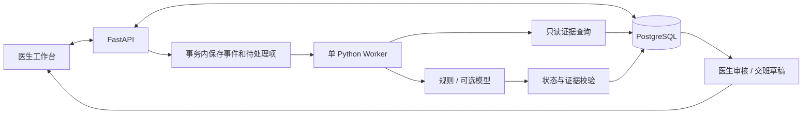

# Medical Agent Assistant · 医疗工作流辅助 Agent

面向住院医生的医疗工作流原型，探索从查房记录、病历辅助书写到检验结果随访和交班的连续协作。

当前已实现一条可持久化的规则工作流：**查房转写／文本 → 病历草稿 → 提取小任务 → 医生确认与排期 → 模拟报告事件自动匹配／手工执行记录 → 提醒审核与版本确认 → 记录处理结论 → 未完成任务交班。**

> 项目使用虚构数据。任务提取和报告调查是规则版。模拟报告事件可自动匹配、恢复任务并生成待审核提醒；尚未接医院检验系统或真实模型，也未实现模型自主工具选择与动态重规划。语音使用浏览器识别能力，病历签署是开发模拟。

## 当前实现与限制

| 模块 | 当前情况 |
| --- | --- |
| 医生工作台 | `index.html` 与 `frontend/workflow.js`；患者、查房完成数、待办及提醒从后端读取；部分账号与设置仍为演示 |
| 患者详情 | 真实病历与历次查房，可按住院查看历史正文、原始转写及任务 |
| 病历文书 | 列表、详情、编辑、模拟签署均读取／写入数据库；保存查房来源 |
| 查房记录 | 浏览器语音转写或文本录入；保存后显示病历入口和小任务，重复提交不重复创建 |
| 任务安排 | 结果随访、复查、监测观察、联系／安排；确认后持久化，支持排期、逾期、执行记录、查看确认、完成／取消和历史 |
| PostgreSQL | 住院、查房、事件、队列、Intent、OpenLoop、证据、交班与审计等表；Alembic 增量迁移 |
| 报告随访 | 按患者、住院、项目和结构化编号核对模拟报告，保留版本与原始证据；报告先到可回查，歧义保留待核实 |
| 交班与提醒 | 新报告生成独立待审核提醒；交班保留未完成任务并可回到报告证据 |
| 身份与审计 | 开发医生范围校验及任务操作审计；尚无真实登录和完整生产授权 |

病历列表每次打开都会请求后端；空列表与读取失败分别显示，不再回退到演示病历或仅在内存中保存。修改转写内容会要求重新核对草稿。

### 历史病历与重复查房

- 在患者列表点击“历史病历”，或打开患者详情后点击“查看历史病历与查房”。页面展示该患者全部可访问住院中的已保存病历及历次查房，按时间倒序排列，可按住院筛选。
- 点击“查看病历正文”读取该次文书；“查看查房原文”读取当次原始转写和保存时草稿；“查看关联任务／继续处理”进入对应查房的工作流。
- “新一次查房”每次新建独立查房、病历和任务来源。同一患者同一天可查房多次，前一次尚未结束也不会阻止新一次记录；“查看／继续上次查房”是单独入口。
- 新记录不覆盖此前正文、签署状态或任务。今日完成数按查房次数统计；原有 ROUND 编号文书可恢复查房来源展示，未改写历史数据。

### 实际操作

1. 选择患者并“开始查房”，录音转写或输入：`明天复查血常规。监测血氧。联系心内科会诊。血培养结果出来后通知我。`
2. 停止录音并核对转写，点击“生成病程草稿”，再“保存病历并提取小任务”。草稿保留原文，不补写未提供的诊疗结论。
3. 保存后可以查看本次病历。逐项核对小任务，填写计划时间，再“确认并加入任务安排”；未识别到任务会明确提示。
4. 候选任务逐项确认或填写原因忽略后，点击“结束本次查房”。查房状态持久化为 COMPLETED，患者列表和首页同步更新；已保存但未结束的查房可以继续处理，未完成的后续任务继续保留。病历审核签署单独进行。
5. 左侧“任务安排”默认显示待办，支持切换已完成／已取消／全部。联系、会诊、监测观察等执行任务填写实际执行情况后点击“记录执行情况并完成任务”；复查及结果随访依次登记结果 → 确认已查看 → 填写处理结论完成。完成后保留时间、来源及历史，旧版本提交被拒绝。
6. “交班摘要”保存当前住院未完成任务及待确认计划的草稿。刷新后病历、任务、排期和处理历史仍可读回。

计划时间由医生确认时填写，不自动推断相对日期；录音文件不上传保存。浏览器不支持识别或识别服务不可用时，需要直接编辑转写文本。

## 规则版事件随访（2026-10-24 已接通）

参考 [ClinLoop](https://github.com/legend91019/ClinLoop) 的任务连续性、证据核对和医生审核思路，在现有项目上逐步实施检验随访闭环。

```text
查房：血培养结果出来后通知我
  → 提取候选随访任务
  → 医生确认，持久化等待条件
  → 模拟检验报告返回
  → 核对患者、此次住院、检验项目及报告来源
  → 生成带证据的待审核提醒
  → 医生查看报告、记录处理结论
  → 如需继续等待药敏，建立后续任务
  → 未完成事项进入交班草稿
```

上述模拟报告链路已按规则版接通。自动匹配必须同时满足患者、此次住院、项目，以及标本号／医嘱号／报告号；没有编号或多份不同报告符合条件时，任务保留等待核实。新结果提醒只表达“报告已返回待医生核对”，不把刚返回、结构化确认缺失直接解释为医生遗漏。提醒保存 5 分钟宽限期元信息；范围仅覆盖本系统明确绑定报告版本的查看确认，尚未综合医院病程等全部来源。

任务详情提供匹配条件、模拟报告返回／修订、证据来源、提醒审核、规则调查记录和失败处理队列。报告 v2 会保留 v1 原文与审核记录，将旧提醒标为已被新版本替代，并让已确认或已完成的相关任务重新进入结果待查看；旧版本页面不能确认新版本。接受／驳回提醒、确认已查看、完成处理始终分开。

### 页面验证步骤

1. 查房输入“血培养结果出来后通知我”，保存后展开候选的自动接收报告选项，填写标本号 `BC-001` 并确认任务。已有等待任务也可在详情中设置匹配条件。
2. 在任务详情展开“开发验证：模拟报告返回／修订”，填写报告号 `BC-R001`、版本 `1`、项目“血培养”、标本号 `BC-001` 和合成原文，保存后任务自动进入结果待查看。
3. 可以先接受或驳回提醒；此时不会确认已查看或完成任务。核对报告后“确认已查看结果”，再填写结论完成处理。
4. 在确认查看后或完成后的任务中，明确建立项目“药敏”、同一标本的后续任务；药敏报告以新报告号返回时会恢复子任务，保持同一 Intent 和父任务关系。
5. 调查轨迹可查看实际 `get_lab_reports` 调用、来源引用、前序 Run、触发事件、规则计划版本和停止原因。尚未确认的药敏任务会进入交班草稿。

`POST /api/lab-reports` 仅在 development 环境开放：先提交原始报告、事件及队列，再尝试处理；失败不会丢报告。`POST /api/events` 可只入队，由单 Worker 后台处理。相同报告版本不能覆盖内容，修订必须使用更高版本号。

### 开发任务

后续开发以 [ClinLoop 最小医疗 Agent MVP 任务计划书](task-plan.md) v3.0 为唯一主清单，替换原任务编号和阶段划分。首版聚焦血培养随访与药敏后续交接，真实模型的自主工具调用是必需验收项。

| 层次 | 交付目标 |
| --- | --- |
| 第 1 层 | 核验已有数据与业务闭环，固定候选和证据契约 |
| 第 2 层 | 完善只读工具，接入一个真实模型 |
| 第 3 层 | 实现有预算的动态调查，证明查询路径随证据变化 |
| 第 4 层 | 完成事件恢复、模型重规划与到期复核 |
| 第 5 层 | 接入医生审核、实际调查轨迹和交接确认快照 |
| 第 6 层 | 合成回放、规则/Agent 对比与完整交付验收 |

保留当前 FastAPI、PostgreSQL、Worker 和前端基础；MCP/AgentArts 平台适配及更多临床场景放在 MVP 后扩展。上述为计划，不代表真实模型已经接通。

## 技术与架构

当前使用 HTML/CSS/JavaScript、FastAPI、SQLAlchemy 和 PostgreSQL，依赖见 `backend/requirements.txt`。

以下为完整目标架构；已有规则提取、队列 Worker、结构化模拟报告证据与医生审核；医院接入和模型尚未落地：



## 本地运行当前原型

建议使用 Python 3.12+ 和一个专用 PostgreSQL 开发数据库。当前前端不需要 Node.js。

### 1. 创建数据库并配置连接

在 PostgreSQL 中创建空的开发数据库：

```sql
CREATE DATABASE health_agent;
```

在仓库根目录执行；已有 `.env` 时不要覆盖：

```powershell
if (-not (Test-Path .env)) { Copy-Item .env.example .env }
```

编辑 `.env`，填写自己的连接信息。密码中的特殊字符需要进行 URL 编码。

```dotenv
DATABASE_URL=postgresql+psycopg://用户名:密码@localhost:5432/health_agent
CORS_ORIGINS=http://localhost:5500,http://127.0.0.1:5500
```

### 2. 启动后端

从仓库根目录执行：

```powershell
python -m venv .venv
.\.venv\Scripts\python.exe -m pip install -r backend/requirements.txt
.\.venv\Scripts\python.exe -m uvicorn backend.main:app --host 127.0.0.1 --port 8000 --reload
```

当前后端默认不在启动时隐式建表；请先执行 Alembic 迁移。若仅做一次性本地原型，可在 `.env` 设置 `AUTO_CREATE_TABLES=true`，共享开发库不建议启用。

接口文档：[Swagger UI](http://127.0.0.1:8000/docs)。

### 3. 可选：写入虚构演示数据

在另一个终端执行，仅用于专用开发数据库：

```powershell
Invoke-RestMethod -Method Post http://127.0.0.1:8000/api/dev/seed
```

当前初始化接口创建两个医生、三个患者、四次住院（其中一个患者两次住院）及三份病历；使用固定业务 ID，重复执行不会重复插入。

### 4. 启动前端

在仓库根目录的另一个终端执行：

```powershell
.\.venv\Scripts\python.exe -m http.server 5500 --bind 127.0.0.1
```

打开 [医生工作台](http://127.0.0.1:5500/index.html)。前端 API 默认地址为 `http://127.0.0.1:8000/api`。

也可直接打开 `index.html` 体验界面，但当前 CORS 默认配置面向上述 HTTP 地址，连接后端时应使用 HTTP 方式访问。

### 后台 Worker

迁移完成后，在仓库根目录的另一个终端运行：

```powershell
python -m backend.worker.main --poll-interval 1
```

只消费一次可用 `python -m backend.worker.main --once`。Worker 只读取待处理／租约过期的队列项，遵守 `retry_at`，失败最多自动尝试 3 次；失败原因通过 `/api/event-jobs` 和任务详情的处理队列查看，开发环境可明确重试。数据库临时不可用时保留任务，记录错误类型后重新连接；不输出完整临床原文。

## 已实现 API

| 方法 | 路径 | 用途 |
| --- | --- | --- |
| GET | `/api/health` | 返回服务、数据库连通及表字段完整性状态 |
| GET | `/api/medical-records` | 病历列表，支持 `q`、`status` |
| GET | `/api/medical-records/{id}` | 病历详情 |
| PATCH | `/api/medical-records/{id}` | 修改未签署病历正文 |
| POST | `/api/medical-records/{id}/sign` | 保存模拟签署状态 |
| POST | `/api/dev/seed` | 初始化虚构演示数据 |

上述接口尚无真实身份认证，仅用于本地原型开发。新增工作流接口见下表。

| 方法 | 路径 | 用途 |
| --- | --- | --- |
| POST | `/api/rounding-sessions` | 保存查房、病历草稿、事件，执行规则提取；支持 request_key 重试 |
| GET | `/api/rounding-sessions?encounter_id={id}` | 本次住院的查房历史、候选处理进度及后续任务汇总 |
| GET | `/api/rounding-sessions/{id}` | 查房原文、病历来源、结束状态与任务完成数 |
| POST | `/api/rounding-sessions/{id}/finish` | 候选处理完成后结束查房；保留后续待办，不隐式签署病历 |
| GET | `/api/patients` | 当前开发医生可操作的患者、当前住院与今日查房次数 |
| GET | `/api/patients/{id}/history` | 真实历史病历与历次查房，支持 encounter_id 筛选，校验医生／患者／住院范围 |
| GET | `/api/encounters/{id}/intents` | 候选小任务 |
| POST | `/api/intents/{id}/confirm` | 确认目标及计划时间 |
| POST | `/api/intents/{id}/reject` | 忽略候选并记录原因 |
| GET | `/api/tasks` | 当前开发医生的任务安排，支持 encounter_id |
| POST | `/api/loops/{id}/{action}` | schedule、record-result、acknowledge、resolve、cancel，以及仅用于执行任务的 complete；提交 expected_version |
| GET | `/api/loops/{id}/history` | 来源病历、结果及操作历史 |
| POST | `/api/lab-reports` | 开发环境保存版本化合成报告，并尝试自动恢复匹配任务 |
| POST | `/api/loops/{id}/matching` | 医生设置精确匹配条件，回查已返回报告 |
| GET | `/api/findings` | 按住院或任务查看带证据的提醒 |
| POST | `/api/findings/{id}/reviews` | 独立接受／驳回，携带期望版本与幂等标识 |
| GET | `/api/evidence/{id}` | 范围受限的原始报告证据与版本 |
| GET | `/api/loops/{id}/runs` | 同一 Intent 的实际工具调用与事件恢复链 |
| POST | `/api/loops/{id}/follow-up` | 医生明确建立同一 Intent 下的依赖任务 |
| GET | `/api/event-jobs` | 当前开发医生可访问的处理状态与错误 |
| POST | `/api/event-jobs/{id}/retry` | 开发环境明确重试当前失败处理项 |
| GET | `/api/encounters/{id}/timeline` | 住院时间线 |
| POST | `/api/encounters/{id}/handoffs` | 持久化未完成事项交班草稿 |
| POST | `/api/medical-records` | 创建带查房来源的病历 |

## 仓库内容

```text
index.html                    医生端单文件原型
frontend/workflow.js          持久化查房、病历和任务交互
frontend/patient-history.js   患者详情、历次病历、查房原文及住院筛选
backend/main.py               FastAPI 入口
backend/models.py             ORM 数据模型
backend/requirements.txt      后端依赖
backend/README.md             后端说明
.env.example                  PostgreSQL 配置示例
task-plan.md                  当前分层 MVP 主计划
docs/plans/2026-10-16-clinical-workflow-mvp-task-book.md
                              升级方案、业务约束和验收规划
UPDATE_NOTES.md               初版功能与后续方向说明
```

## 验证与评测计划

当前 `python -m pytest -q` 通过 39 项测试，涵盖状态机、DTO、工具范围、事件幂等，以及查房保存／重试、病历读回、多目标提取、任务排期与状态流转、交班和越权拒绝。`tests/browser_rounding_smoke.py` 在独立临时 SQLite 数据库验证完整页面链路、刷新读回及正文 HTML 安全显示（需要前端 :5500、独立 Chromium/Edge CDP :9222 和可选 websockets 包，不测试真实麦克风／语音识别服务）。`python tests/postgres_rounding_smoke.py` 可在当前 PostgreSQL 的回滚事务内验证结束查房与四类任务完成，保留原有数据。新增测试覆盖报告先到回查、错住院／错标本／错项目不匹配、多报告歧义、重复投递、报告修订与旧页面冲突、独立提醒审核、两次事件恢复、父子任务、失败延迟重试及耗尽后明确重试。浏览器和当前 PostgreSQL 的回滚事务均已验证培养 → 药敏事件链路。后续仍需完整故障点、并发压力、性能预算、真实模型和独立病例评测。

规则、模拟模型和真实模型应分开报告。用独立合成病例统计提醒精确率、召回率、证据有效率、处理失败数和交班遗漏；没有实际测评前不宣称准确率或节时效果。

## 数据与使用边界

示例仅使用虚构病例，不上传真实患者信息、录音、数据库、密钥或 `.env`。`.gitignore` 应与源码一起提交；`.env.example` 只保存占位值。

项目用于软件原型与研究验证，不用于真实诊疗。未来模型输出只提出候选任务和提醒；正式任务状态由后端规则和医生操作控制，系统不自动诊断、开立医嘱或关闭高风险临床任务。
