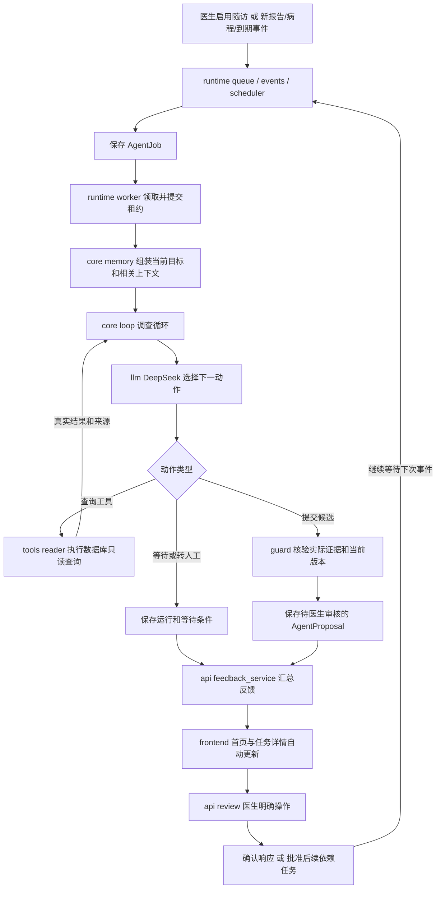

# ClinLoop Agent 业务架构与代码导航

所有 Agent 专属实现集中在本目录。先从这份说明看业务链路，再进入各组件代码。配置、前端操作和验证命令见 [USAGE.md](USAGE.md)。

当前采用同一项目内的模块划分：Agent 复用 backend 的患者、住院、病历、报告、权限、数据库连接与通用任务服务；本目录没有另建一套患者系统，也不是可脱离业务后端直接运行的独立 SDK。

## 目录与职责

```text
agent/
├── README.md                    业务架构、调用链和阅读顺序
├── USAGE.md                     配置、操作、API 和验证说明
├── contracts.py                 Agent 输入、动作、候选、预算和运行结果
├── core/
│   ├── loop.py                  核心决策循环：模型决定下一步，执行后再判断
│   └── memory.py                组装上下文，保存目标的最新计划和等待条件
├── llm/
│   ├── prompts.py               角色、任务边界、行动规则和提示词版本
│   └── deepseek.py              DeepSeek 请求、超时、结构解析和错误分类
├── tools/
│   ├── reader.py                白名单只读工具，注入授权患者和住院范围
│   └── evidence.py              读取原始来源、生成内容摘要和证据快照
├── guard/
│   └── evidence.py              校验证据、报告版本、查询覆盖和响应宽限期
├── runtime/
│   ├── queue.py                 幂等入队，把一次调查保存为 AgentJob
│   ├── events.py                根据临床事件唤醒已启用的随访目标
│   ├── scheduler.py             到期复核，避免没有外部事件就一直等待
│   ├── worker.py                领取租约、调用调查、核验并保存结果
│   └── clock.py                 UTC 时间工具
├── persistence/
│   └── models.py                AgentRun、AgentStep、AgentJob、AgentProposal
├── api/
│   ├── router.py                汇总 /api/agent 路由
│   ├── common.py                医生访问范围、启动前提和通用请求结构
│   ├── investigations.py        启动/重试调查、病程事件、轨迹与证据读取
│   ├── review.py                医生审核候选、确认响应、批准后续依赖任务
│   ├── feedback_service.py      把调查和审核状态整理成医生反馈
│   └── handoff.py               交接历史、新版本与确认快照
├── frontend/
│   ├── workspace.js             任务详情里的 Agent 面板、审核与交接交互
│   └── feedback.js              首页反馈中心、通知入口与任务进展摘要
└── evaluation/
    └── smoke.py                 使用临时合成库的在线验收入口
```

## 一次随访是怎样运行的



网络请求发生在已提交租约之后，不持有临床写锁。调查完成后再次检查任务版本与来源变化，符合条件才保存候选。模型输出不能直接完成临床任务。

## 用血培养场景对照代码

| 业务问题 | 查看文件与入口 |
| --- | --- |
| 报告返回后，哪些任务应被唤醒？ | runtime/events.py 的 enqueue_event |
| 怎么保证同一事件不重复创建调查？ | runtime/queue.py 的 enqueue |
| 目标、前序计划和等待条件从哪里取？ | core/memory.py 的 build_context / remember_outcome |
| Agent 怎样决定先查报告还是病程？ | core/loop.py 的 investigate；llm/prompts.py 定义行动要求 |
| 谁真正调用 DeepSeek？ | llm/deepseek.py 的 DeepSeekProvider.next_action |
| 模型提出查病程，谁去数据库查？ | tools/reader.py 的 execute_read |
| 如何防止编造引用、错患者和旧报告？ | guard/evidence.py 的 validate_candidate / recheck_snapshots |
| 运行轨迹、候选、失败重试保存在哪里？ | persistence/models.py；runtime/worker.py |
| 医生在哪里看到调查结论？ | api/feedback_service.py → frontend/feedback.js |
| 医生批准“继续等待药敏”后怎么建任务？ | api/review.py；复用 backend 中的任务与报告回查服务 |
| 未完成事项怎样进入交接？ | backend/routes/tasks.py 生成草稿；api/handoff.py 管理版本和确认 |

## 建议阅读顺序

1. contracts.py：先了解目标输入、四类动作、候选与结果。
2. core/loop.py：看 Agent 每轮怎样决定和执行下一步。这是自主调查的核心。
3. llm/prompts.py → llm/deepseek.py：看目标如何交给模型，以及模型动作如何被解析。
4. tools/reader.py → guard/evidence.py：看工具执行与证据核验的边界。
5. core/memory.py → runtime/events.py → runtime/worker.py：看跨事件恢复与持久化。
6. api/review.py → api/feedback_service.py → frontend/：看结果如何交给医生并落入工作流。

## 哪些是 Agent，哪些是业务控制

| 部分 | 谁决定 | 当前职责 |
| --- | --- | --- |
| 下一步调查动作 | 模型，受 core/loop.py 预算约束 | 选工具、根据返回调整行动、提交候选、等待或转人工 |
| 数据访问与身份范围 | tools 和共享权限代码 | 实际查询、时间窗口、完整性和授权范围 |
| 证据是否可用于候选 | guard | 核对真实来源、版本和检索覆盖，不证明临床正确性 |
| 唤醒、重试、状态保存 | runtime 和 persistence | 确定性后台运行机制 |
| 报告响应确认与后续任务批准 | 医生，通过 api/review.py | 明确操作并审计；接受候选不等于任务完成 |
| 反馈与交接展示 | api 和 frontend | 把当前持久化结果交给医生处理 |

目前查房初步任务提取、结构化报告匹配和正式任务状态机仍在 backend 中，由现有规则与业务服务完成。Agent 重点承担跨来源调查和后续计划候选，不把全部普通业务模块都称为智能体。

## 与原项目的连接点

- backend/main.py：挂载 agent/api/router.py，现有 API URL 保持不变。
- backend/worker/processor.py：临床事件提交时调用 agent/runtime/events.py。
- backend/worker/main.py：同一 Worker 进程驱动事件处理、到期调度和 Agent 调查。
- backend/models.py：只保留四个 Agent ORM 类的兼容导出；实际定义已迁到 persistence/models.py，表名和字段没有改变，无需新数据库迁移。
- backend/routes/agent.py：旧导入路径的薄兼容入口，不包含第二套实现。
- backend/agent/smoke.py：旧在线验收命令的薄兼容入口；新命令是 python -m agent.evaluation.smoke。
- index.html：加载 agent/frontend/feedback.js 与 agent/frontend/workspace.js；共用 frontend/workflow.js 的业务交互和请求工具。
- tests/test_agent_*.py：契约、调查、故障恢复和医生反馈测试继续集中在项目测试目录。

本次仅整理代码架构，不新增 Agent 能力，不触发真实模型调用。已有验证轨迹位于 docs/verification/，运行方式和验证边界见 USAGE.md。

## 入院记录 Agent

`admission/` 负责问诊与检查结果到入院草稿的独立工作流，复用现有DeepSeek配置和患者、住院、病历、报告存储。

- `models.py`：持久化问诊、补充检查、输入版本、生成状态、草稿、来源快照与步骤。
- `sources.py`：限定本次患者住院，只取各报告最新版本并计算摘要。
- `contracts.py`、`prompts.py`：三种只读动作、九章节输出与资料不足规则。
- `provider.py`：DeepSeek结构化请求、超时和安全错误分类。
- `loop.py`：最多6次模型决定、100秒总预算，校验已读工具与来源引用。
- `service.py`：生成租约、保存前核对版本、草稿落库与审查前资料检查。
- `frontend/admission.js`：语音转写、资料保存、生成反馈、来源缺项展示与医生审查签署。
- `smoke.py`：仅使用固定合成资料做在线验证，不写开发数据库。

输入保存及生成请求由 `backend/routes/patients.py` 接入；规则服务 `backend/services/admission_service.py` 计算24小时截止与审查待办。Agent不能签署或关闭待办。当前生成在有超时上限的HTTP请求中执行，问诊资料、状态及草稿均持久化；这部分尚未接入随访Agent的后台队列。
